# block_size 对混合注意力推理的影响

> 模拟 / 量化：4 个实验台、18 个可复跑脚本。除特别标注外，全部数字来自本机实测（RTX 4060 Laptop 8 GB, sm_89, 24 SM）与真实 trace 仿真。

## 1. 问题：这个旋钮为什么不可调

混合注意力模型（Qwen3.5 / Kimi K3 / DeepSeek V4 等）让一个请求同时持有多种缓存对象：全注意力层的 KV、滑动窗口层的 KV、线性注意力的循环状态、卷积/压缩器状态。它们的**大小跨度极大**（几 KB 到几 MB）、**生命周期完全不同**。

vLLM 的 HMA 为了让这些对象**共用一个物理池**，规定了两条分组规则，第二条是：

> **Identical page size across groups: Because our memory pool only have one page size.**

于是统一页大小取各组块大小的**最小公倍数**（`scheduler_block_size = lcm(...)`），代价是**全注意力层的 `block_size` 被推导出来、用户不能手动调节**。

### 1.1 为什么 lcm 会把页放大

设第 $i$ 类对象的块大小为 $b_i = 2^{k_i} m_i$（$m_i$ 为奇数），则统一页

$$P=\operatorname{lcm}(b_i)=2^{K}\Lambda,\qquad K=\max_i k_i,\ \Lambda=\operatorname{lcm}(m_i)$$

**奇数部分 $\Lambda$ 是放大器**：只要有一个对象的奇部很大，整页就被它撑开。闭式（令 $j^*=\arg\max_i k_i$）：

$$P=\frac{b_{j^*}\cdot\Lambda}{m_{j^*}}$$

可行性条件：$\Lambda \le B/2^{K}$（$B$ 为页大小上限）。**只要把"2 的幂次最高的对象"的奇部也取成 $\Lambda$，统一页立刻塌缩** —— 这就是第 5 节零成本修法的来源。

### 1.2 四个真实取值，全在同一个族里

| 块大小 | 分解 | 奇数部分 | 出处 |
|---|---|---|---|
| **528** | $2^4 \cdot 33$ | **33** | 会议纪要实测；vLLM issue #37121 评论确认 Qwen3.5 hybrid 的 prefix-cache 粒度即 528 |
| **784** | $2^4 \cdot 49$ | **49** | LMCache hybrid 文档里的 vLLM 启动日志 |
| **1568** | $2^5 \cdot 49$ | **49** | 我们的对象组合 |
| **2096** | $2^4 \cdot 131$ | **131** | vLLM PR #35703 举例：Qwen3.5-397B-A17B-FP8 / TP2 |

**参照系**：综述所述 PagedAttention 分配单元通常 **16–32 token**；混合注意力模型落在 **528–2096**，差 **16–131 倍**。

## 2. 结论

| 维度 | 最优 block_size | 偏离代价（实测） |
|---|---|---|
| 全注意力 kernel | **因配置而异**（8 个配置 8 种最优） | 32–512 内仅 3/8 配置在 1.10× 内；最差 **6.32×**（bs≤16）、**7.55×**（b1-4k@512） |
| KV 传输 | **越大越好** | 128k/RDMA400G：**803.6→410.5 ms（−48.9%）**；NVLink4：**927.2→56.2 ms（16.5×）** |
| 前缀缓存复用 | **与负载共享粒度对齐** | 同为 bs=528，损失从 **0.93%** 到 **100%** 不等 |
| 显存尾块 | **短请求偏好小块** | 8 GB 池、600-token 请求：并发 **95→55（−42%）**；bs=2048 尾块浪费 **28.7%** |

**一句话**：损失主要来自「**块大小与负载共享粒度不对齐**」，而不是块大小本身；**kernel/传输偏好大块，复用/尾块偏好小块**，四维合一的均衡点在 **128–256**。

### 2.1 「固定」才是问题，不是「值大」

把结论从“值多大多小”换到“这个值被固定意味着什么”，问题性质就变了——前者不同负载各有答案，后者是结构性缺陷。

1. **失去调节入口**：普通模型上 `--block-size` 一直是公开参数，上游正在把默认值从 16 调到 64（PR #63231）；混合注意力模型的块大小由统一页 lcm 推导，显式指定会被覆盖。
2. **决定权落在无关组件上**：块大小由最大的缓存对象（Mamba 状态）决定——状态越大、块越大，模型一换就跳（Qwen3.5 为 528，Qwen3.5-397B 为 2096），调用方无法干预。
3. **无法适配负载差异**：同为 528，Conversation 型损失 100%、Tool-Agent 15.3%、Agentic 0.02%；kernel 侧 8 个配置有 8 种最优。固定一个值必然在部分负载上最差，且部署前无法预知线上是哪种负载。
4. **无法满足后端约束**：后端白名单只接受 16/32/64 的倍数，528 与 1568 各丢 3 条路径并被**静默换后端**；非 2 的幂还要多付 7.3% 的 lane padding。

因此「固定」的代价不是平均变慢，而是**选择权交出去之后，用户既不能改、也不能提前发现**。

## 3. 实验设置

| 项 | 取值 |
|---|---|
| 硬件 | RTX 4060 Laptop，8 GB，sm_89，24 SM；torch 2.11.0+cu128，triton 3.8.0 |
| kernel 实现 | 自写 Triton paged-decode kernel（vLLM v2 结构），16 种块大小 × 8 个配置 |
| KV/token | **144 KiB**（2(K+V)×36 层×8 KV head×head_dim 128×bf16） |
| trace | 4 组，详见 §3.1（含下载地址与真实/合成标注） |
| 预算 | 8 / 16 / 40 / 160 GB（另设"不淘汰"参考口径） |
| 淘汰策略 | LRU（块粒度），当前请求的块在结束前不可淘汰（同 vLLM `ref_cnt>0`） |
| 命中语义 | 从第 0 块起连续命中的整块数，遇第一个 miss 即停；尾块不缓存 |
| 换算 | `capacity_blocks = ⌊budget / (block_size × 144 KiB)⌋`；prefill 0.06 ms/token（线性 proxy，仅用于同负载相对比较） |

### 3.1 实验用了哪些 trace

**前提**：这批 trace 都**不携带模型身份**。Mooncake 与 LMCache 记录的是请求形态（到达、输入长度、前缀哈希集合），与具体模型无关；「混合注意力」是我们套用的对象，不是 trace 自带的属性。

| trace | 下载地址 | 规模（本次使用） | 长度 mean / p95 / max | 共享结构 | 仿真套用的模型几何 |
|---|---|---|---|---|---|
| **Mooncake Conversation** | [conversation_trace.jsonl](https://raw.githubusercontent.com/kvcache-ai/Mooncake/main/FAST25-release/traces/conversation_trace.jsonl) | 1200 请求 / **16,848,754** token | 14,041 / 47,730 / **122,889** | 相邻请求公共前缀**恰好 1 个 512-token 块**（1200 对全部如此） | Qwen3.5-9B 类，**144 KiB/token** |
| **Mooncake Tool-Agent** | [toolagent_trace.jsonl](https://raw.githubusercontent.com/kvcache-ai/Mooncake/main/FAST25-release/traces/toolagent_trace.jsonl) | 1200 请求 / **11,473,215** token | 9,561 / 27,158 / **121,924** | 跨多个 chunk，长度混杂 | 同上 |
| **LMCache Agentic** | [train-00000-of-00005.parquet](https://huggingface.co/datasets/sammshen/lmcache-agentic-traces/resolve/main/data/train-00000-of-00005.parquet) | 10 session / 500 iteration / **15,326,575** token | 30,653 / 53,897 / **86,109** | 相邻 iteration 共享 **>99%**，前缀长且连续 | **真实 tokenizer：Qwen/Qwen3-8B**；几何 144 KiB/token |
| **合成 Agentic**（兜底） | 本地生成器 `workload.gen_synthetic_agentic()`，无外部地址 | 200 session → 2591 请求 / **35,582,283** token | 13,733 / 28,363 / **41,349** | Zipf(α=1.1) 文档共享（受控构造） | 同上 |

**数据集入口**：Mooncake 仓库 <https://github.com/kvcache-ai/Mooncake>（目录 `FAST25-release/traces/`）；LMCache agentic 数据集 <https://huggingface.co/datasets/sammshen/lmcache-agentic-traces>。

**三点必须说明**：

- **只有 LMCache 给了真 tokenizer**（Qwen3-8B）。Mooncake 的 `hash_ids` 是**块大小 512 token** 的前缀哈希（官方 README 明示，我们逐条校验 `len(hash_ids) == ceil(input_len/512)`）——这就是「528 打不过 512」的现场来源。
- **合成 Agentic 完全由本地代码生成**（随机种子 20261026，可复现）：200 session、每 session 5–20 轮、全局共享系统提示 800–2000 token、以 35% 概率注入 512/1024/2048 长度的文档、文档池 500 篇按 Zipf 抽取。它只用于**受控对照**（考察共享密度对块大小伤害的影响），**不是真实负载证据**。
- **KV 传输用的是另一套几何**：Qwen3.5-9B 类 128 KiB/token（32 层，128k 下总 16 GiB），以及 Kimi-K3 类 768 KiB/token（假设值，其公开规格未发布，仅看趋势）。两处几何不同，引用时请对上是哪个实验台。


## 4. 实验结果

### ① kernel：8 个配置有 8 种最优，不存在通用最优值

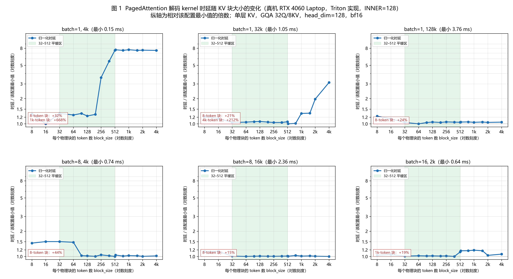

- 8 个配置（不同 batch / 上下文长度 / 头数）各自的最优块大小**互不相同**；
- **32–512 区间内只有 3/8 个配置彼此在 1.10× 以内**；
- 最差情形：bs≤16 时 **6.32×**，b1-4k@512 时 **7.55×**；
- **lane padding** 造成的额外开销占 **7.3%**（1.2155–1.3046 ms）—— 这是"块大小不是 2 的幂"的直接代价。

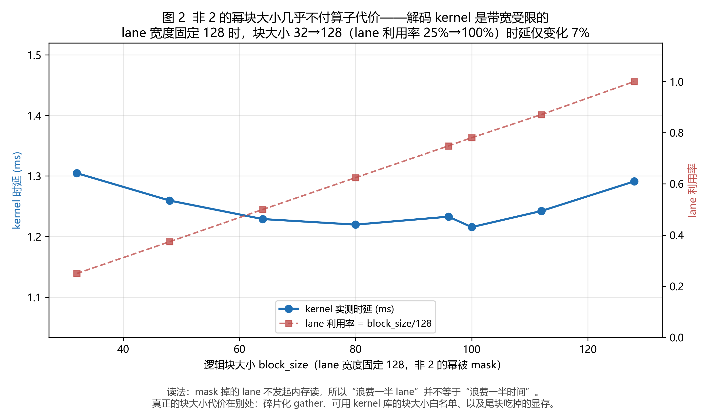

**后端白名单**（源码级核对）：FlashAttention 通用路径要求 16 的倍数，SM90+FP8-KV 固定要 **64**，FA4+head_dim256 固定 64；FlashInfer 只接受 **16/32/64**（Blackwell 才放宽）；XPU 要 64。**528 与 1568 各丢 3 条路径**，最大的 5760 反而全兼容；不合格时 vLLM 会**静默换后端**。

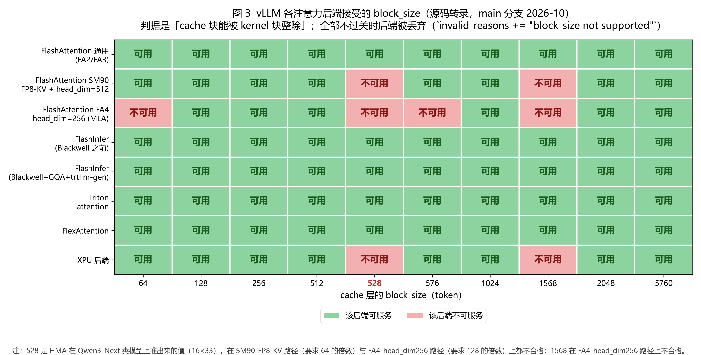

### ② KV 传输：代价全在描述符数量，不在带宽

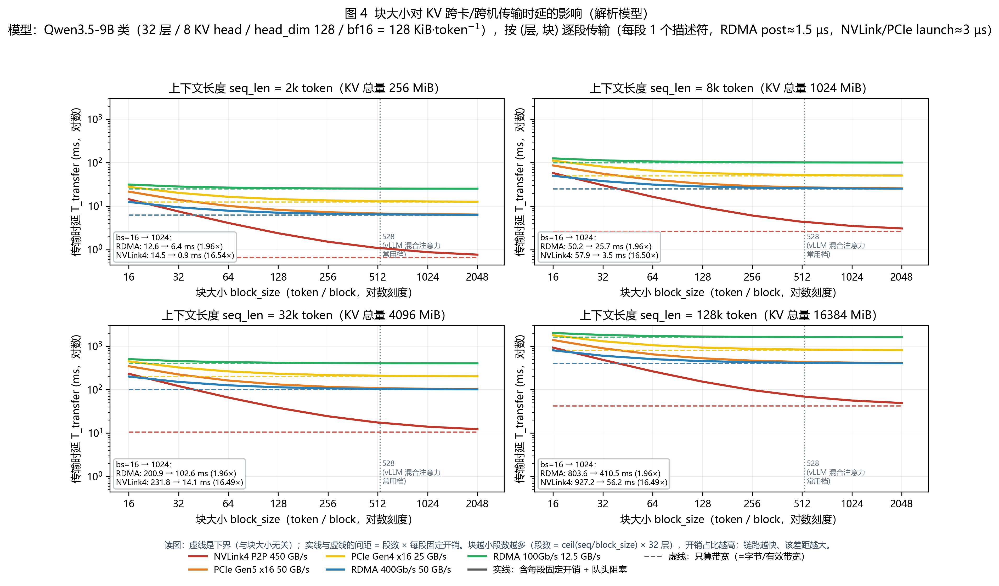

128k 上下文、Qwen3.5-9B 类几何（128 KiB/token，总 16 GiB）的完整扫描（单位 ms）：

| 链路 | bs=16 | bs=64 | bs=256 | bs=1024 | bs=2048 | 只算带宽（下界） | bs16→1024 |
|---|---:|---:|---:|---:|---:|---:|---:|
| **RDMA 400G** | **803.59** | 504.07 | 429.19 | **410.47** | 407.35 | 404.23 | **1.96×（−48.9%）** |
| **NVLink4** | **927.15** | 263.60 | 97.71 | **56.24** | 49.33 | 42.42 | **16.5×（−93.9%）** |
| PCIe Gen5 x16 | 1387.27 | 649.99 | 465.67 | 419.59 | 411.91 | 404.23 | 3.31× |
| PCIe Gen4 x16 | 1791.50 | 1054.22 | 869.90 | 823.82 | 816.14 | 808.46 | 2.17× |
| RDMA 100G | 2016.29 | 1716.77 | 1641.89 | 1623.17 | 1620.05 | 1616.93 | 1.24× |
| NVLink4（packed 对照） | 70.06 | 49.33 | 44.14 | 42.85 | 42.63 | 42.42 | 1.64× |
| RDMA 400G（packed 对照） | 416.71 | 407.35 | 405.79 | 404.43 | 404.33 | 404.23 | **1.03×** |

- **真机实测 GPU 侧按块聚合拷贝几乎不吃块大小**：100.3–103.7 GB/s，全扫描 ±1.7%；
- 瓶颈在**发起侧**：每块批量路径 ~5 ns，逐块独立发起 1.8 µs（CUDA Graph 去 host 派发）/ 75–102 µs（含 host 派发）；
- 所以**传输与 kernel 同向、偏好大块** —— 这与"复用偏好小块"构成第一重冲突。

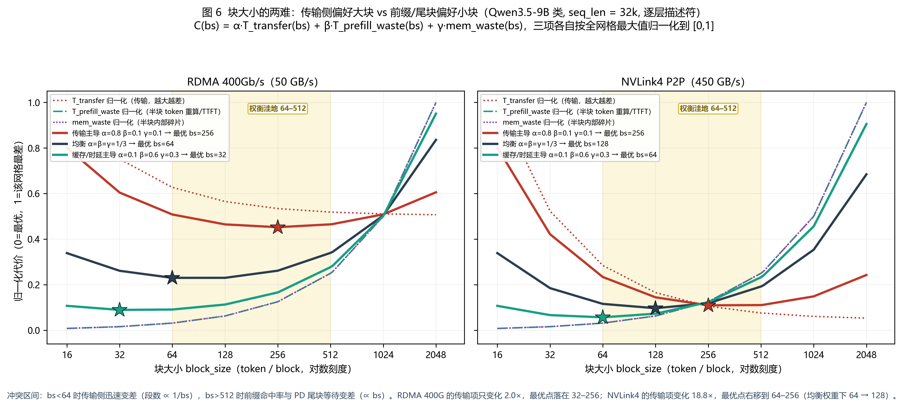

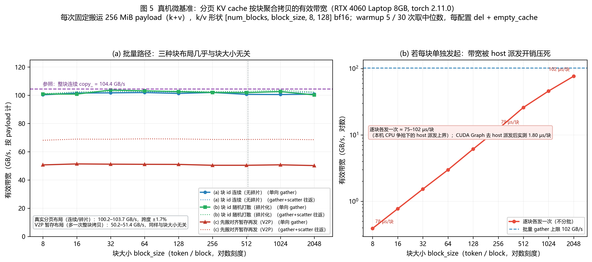

### ③ 前缀缓存复用：伤害取决于负载，不取决于块大小本身

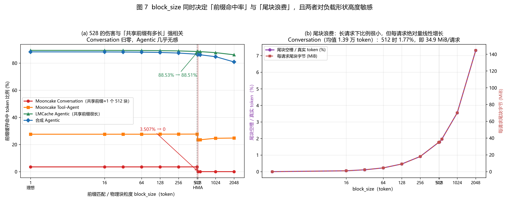

**Mooncake Conversation，8 GB，1200 请求的完整扫描**：

| block_size | 1 | 16 | 32 | 64 | 128 | 256 | 512 | **528** | 576 | 1024 | 2048 |
|---|---:|---:|---:|---:|---:|---:|---:|---:|---:|---:|---:|
| 命中率 | 3.507% | 3.507% | 3.507% | 3.507% | 3.507% | 3.507% | 3.507% | **0.000%** | 0.000% | 0.000% | 0.000% |
| 尾块浪费 | 0 | 0.054% | 0.11% | 0.23% | 0.46% | 0.92% | 1.77% | 1.79% | 1.96% | 3.55% | 7.32% |
| 尾块/请求 | 0 | 1.06 MiB | 2.21 | 4.49 | 9.11 | 18.08 | 34.94 | 35.30 | 38.79 | 70.10 | 144.50 |

**为什么前七列几乎全平**：该 trace 的每个请求与**前一个请求的共享前缀恒为恰好 1 个 512-chunk**（1200 条相邻对，LCP 分布 100% 落在 1 chunk）。因此任何**整除 512** 的块大小看到的共享结构完全相同；而 **528 不整除 512**，连这唯一一个 chunk 也吃不到。

**换负载，伤害立刻不同**（8 GB）：

| 负载 | 特征 | bs≤512 | bs=528 | 相对损失 |
|---|---|---:|---:|---:|
| Mooncake Conversation | 相邻请求共享恰好 1 个 512-chunk | 3.507% | **0.000%** | **100%** |
| Mooncake Tool-Agent | 共享 1–N chunk，粒度混杂 | 27.574% | 23.434% | **15.3%** |
| LMCache Agentic（10 session） | 相邻 iteration 共享 >99%，上下文 1–6 万 token | 89.342% | 88.512% | **0.93%** |
| 合成 Agentic（200 session） | 同上但更短 | 88.243% | 86.171% | **2.35%** |

**512 vs 528 在不同预算下**（Conversation，1200 请求）：

| 预算 | hit@512 | hit@528 | 损失 token | 占 hit@512 | 每请求损失 | 累积到 25,088 需请求数 |
|---|---:|---:|---:|---:|---:|---:|
| 8 GB | 590,848 | **0** | 590,848 | **100%** | 492.4 | **51.0** |
| 16 GB | 611,328 | **0** | 611,328 | **100%** | 509.4 | 49.2 |
| 40 GB | 613,888 | **0** | 613,888 | **100%** | 511.6 | 49.0 |

> **结论**：前缀越长、越集中在块边界上，块大小的边际伤害越小；Conversation 型的共享恰好在 512 边界，528 就整段吃不到。**不能说"528 是通用灾难"**。

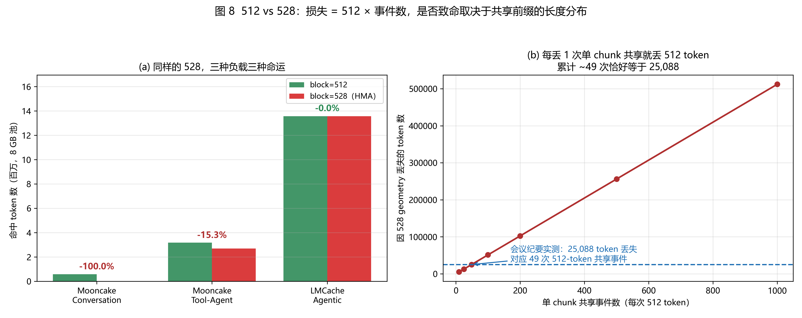

### ④ 容量与尾块：短请求被大块"平均"掉一半

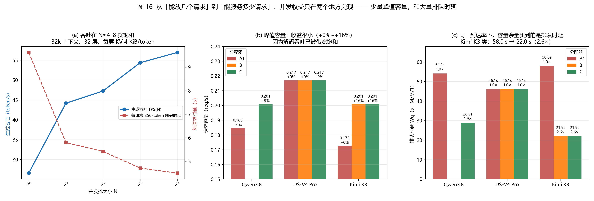

- 块越大，每个驻留请求的**尾块 padding** 越多（平均半个块）：bs=2048 时尾块浪费占真实 token 的 **28.7%**（bs=512 为 1.77%、34.9 MiB/请求）；
- 8 GB 池、600-token 短请求：并发随块增大从 **95 掉到 55（−42%）**；
- 三档对象组合下填充率 $\tau$ 分别为 **4.1% / 46.5% / 83.3%**。

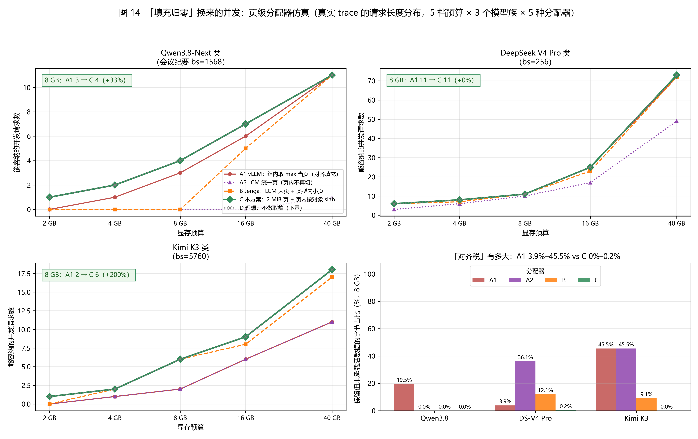

### ⑤ 四维合成：把四把尺子换成一把（ms/请求）

32k 上下文 + 256 token 输出 + PD 分离 + RDMA 400G：

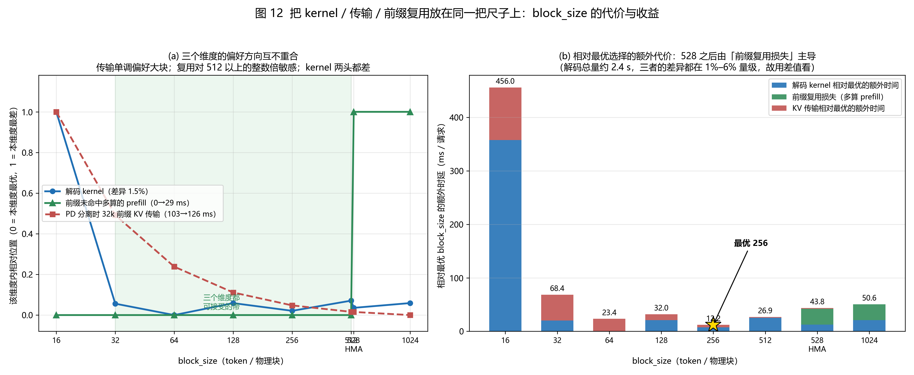

- 最优点 **bs=256**；
- 偏离代价：bs=16 **+443.8 ms**、528 **+31.6 ms**、1024 **+38.5 ms**、512 **+14.8 ms**、64 **+11.2 ms**。

**会议纪要里四个模型的落点**（同口径）：

| 模型（块大小） | kernel | 复用损失 | 传输 | 合计 | 尾块/真实 token | 判断 |
|---|---:|---:|---:|---:|---:|---|
| Qwen3.8-Flash-Next（1568） | 2453.7 | 29.5 | 102.1 | **2585.3** | 4% | 严重偏大：复用归零 + 尾块吃掉大半显存 |
| DeepSeek V4 Flash（64） | 2418.9 | 0.0 | 126.0 | 2545.0 | 0% | 在可用带内 |
| DeepSeek V4 Pro（256） | 2426.4 | 0.0 | 107.3 | **2533.7** | 1% | 在可用带内 |
| Kimi K3（5760） | 2417.0 | 29.5 | 101.8 | 2548.3 | 4% | 严重偏大 |

**64 / 256 在带内，1568 / 5760 在带外** —— 与四维最优区间 128–256 一致。

## 5. 一条零成本修法

既然统一页被 $\Lambda$（奇部）撑开，就把**"2 的幂次最高的对象"的奇数部分也取成 $\Lambda$**，统一页立刻塌缩：

| | 修法前 | 修法后 |
|---|---|---|
| 全注意力块大小 | **1568** | **512** |
| 统一页 $P$ | **36.75 GiB** | **768 MiB** |
| 成本比 | — | **0.98**（几乎不变） |
| Conversation 复用 | 0% | **3.507%** |

**这不是调经验比例，而是整除性修复**（AVMP 已评估并否定过"调比例"那条路）。

**但它只消一半**：能消「页被最大对象撑爆」，**消不掉「小奇数对象塞进大页」**（如 21 KiB 卷积状态，奇部 21，整数页体系下怎么取 $\Lambda$ 都除不尽）。后一半必须靠**机制**（子页 slot + kernel 直接寻址），DualPools 的 S2 正是做这一半，且它自认非零成本。

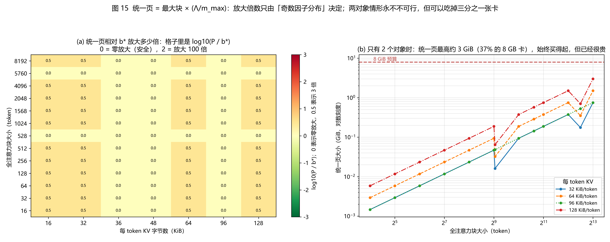

## 6. 上游证据（九段）

| # | 证据 | 出处 |
|---|---|---|
| 1 | **一个池只能有一个页大小**（"Because our memory pool only have one page size."） | 设计文档规则 2 |
| 2 | **块大小被推导**："Increase `block_size` until ≥ `state_size_mamba`"，并自认 "**more than 400**, **which is too large**" | 同文档 Case 4 |
| 3 | 运行时打印块大小：**784 tokens** | LMCache 文档里的 vLLM 启动日志 |
| 4 | 上游自己量过一次：61,776 tokens / 7.57 GiB vs 8,447 / ~1 GiB → **13.7% / 7.313×** | vLLM issue #37121 |
| 5 | 层分组有 **8 个 padding 层**（Gemma-3-27B：62 真实层占 70 槽 = **12.9%**） | 同文档 Case 3 |
| 6 | 最接近的系统 **DualPools 把 512 写死、从未扫过粒度** | arXiv 2610.15755 |
| 7 | 反向证据：**布局**本身可带来 15.6×，端到端却只变 ±0.2% | GraniKV, arXiv 2608.15584 |
| 8 | 34 页综述**从不使用** `block size` / `page size` / `lcm`（各 0 次），且把 granularity 列为**第五个候选轴后以「派生属性」为由排除** | arXiv 2607.02574 |
| 9 | 上游**正在为普通模型把默认 `--block-size` 从 16 调到 64**，却不为混合注意力模型留回路 | PR #63231（open） |

> 第 9 段是最有力的对照：不是"上游不知道这个旋钮重要"，而是"**上游为普通模型调它，却为混合注意力模型锁死它**"。

## 7. 适用范围（诚实边界）

- kernel 数字来自 **8 GB 笔记本 GPU 上的自写 Triton kernel**：趋势可信、绝对值不可外推；
- KV 传输是**解析模型**（本机无 RDMA/NVLink），用真机 gather 带宽（100.3–103.7 GB/s）作锚点；
- **528 的伤害是负载相关的**（余数机制），不能讲成通用灾难；Agentic 型只损失 0.93%；
- **粒度 × 布局的正交实验尚未运行**（需 1 张 ≥24 GB 卡），因此「粒度是一阶变量」目前止于四维曲线 + 四家都不扫，**暂不主张因果分离**；
- 仿真器未建模 radix tree、抢占、recompute，命中率是**结构性上界**。

## 8. 复现

```bash
python experiments/30_kernel_bench/bench.py     # kernel 扫描
python experiments/20_kv_transfer/sim.py        # 传输模型
python experiments/10_prefix_cache_sim/sim.py   # 前缀复用仿真
python experiments/40_synthesis/synthesize.py   # 四维合成
```

数据在各自 `results/*.csv`；每个实验台有 `FINDINGS.md` 记录参数假设与结论。
